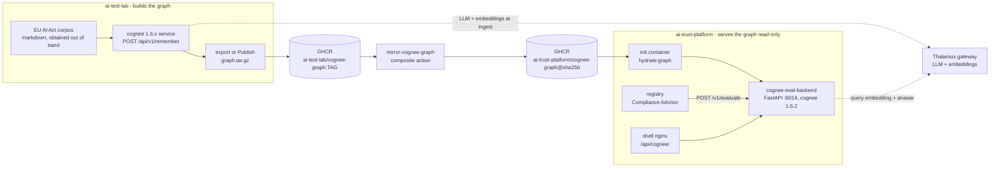
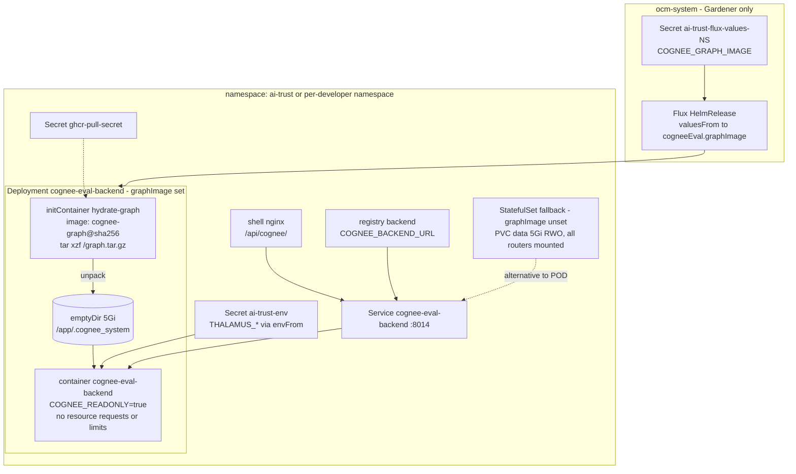
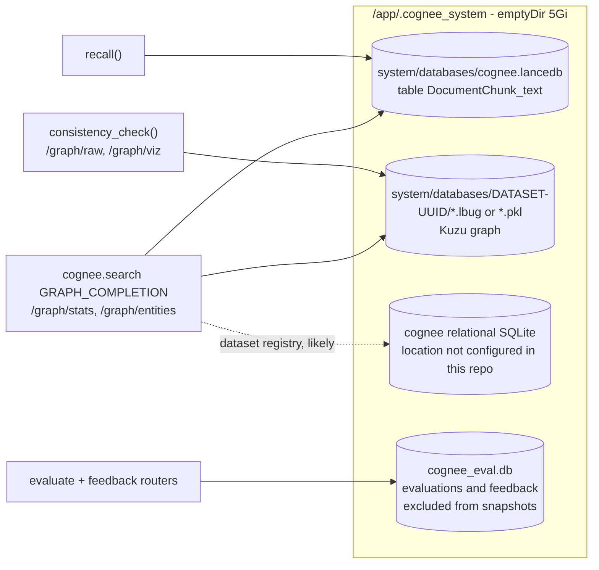
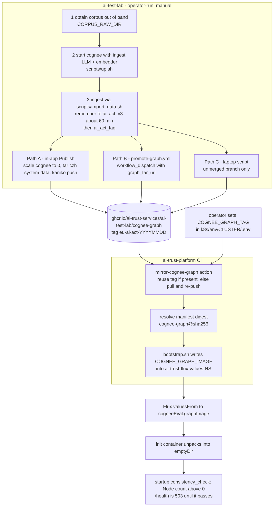
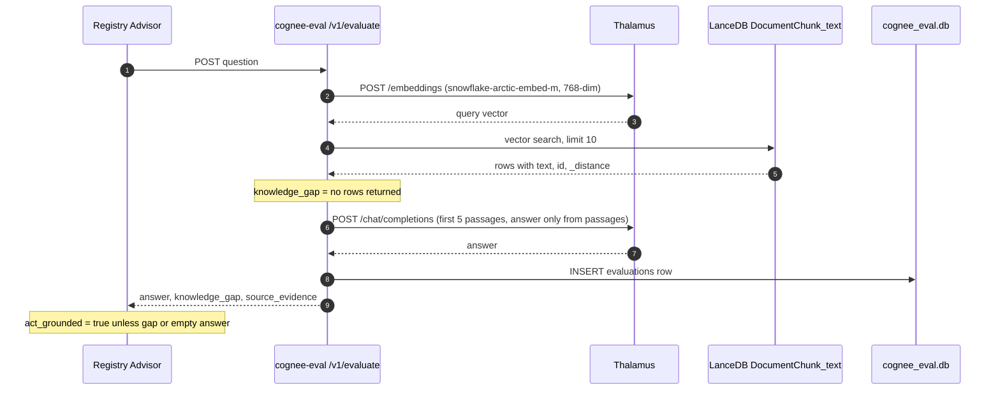
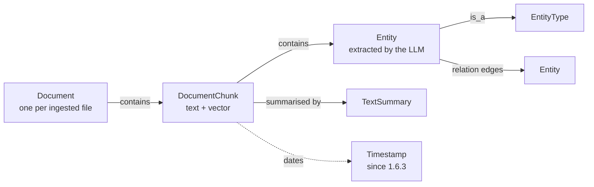
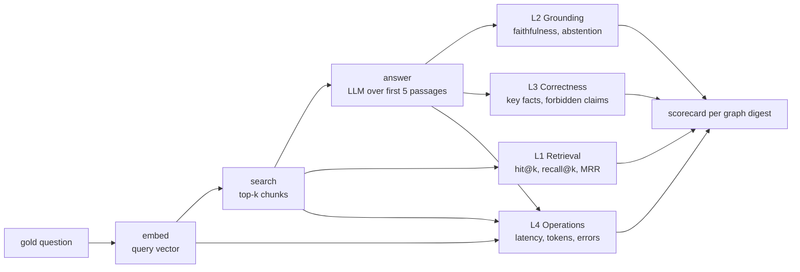

# Cognee architecture — current state, production pattern, accuracy tracking

> **Status: internal, AI-assisted analysis (Claude). Static review only — nothing was run, no cluster, registry or snapshot image was accessed. Validate before sharing outside the team.**
> Evidence base: `ai-trust-platform` branch `cognee-review` @ `4531d686`; `ai-test-lab` `main` @ `1598318` (2026-11-17); cognee documentation and open-source repository as read on 2026-11-23.
> This is a working document: nothing here has been reviewed by the owners of either repo.

**How to read claims.** `[F]` fact, backed by a `path:line` you can open. `[A]` analysis, derived from facts. `[O]` opinion / recommendation. Paths are relative to the repo named in the section; `lab:` means `ai-test-lab`, everything else is `ai-trust-platform`.

---

## 1. Executive summary

**What the "cognee brain" is.** Two repos, one brain. `ai-test-lab` ingests the EU AI Act into a cognee knowledge graph and freezes it as an OCI data image. `ai-trust-platform` mirrors that image and serves it **read-only** through one workload, `cognee-eval-backend` (embedded cognee 1.6.2: SQLite + LanceDB + Kuzu on an `emptyDir`). The only runtime consumer is the registry's Compliance Advisor (tool `search_eu_ai_act`).

**What the review found**

1. **The graph is not on the answer path.** [F] A question is answered by one embedding call, a direct LanceDB top-k vector search over document chunks, and one chat-completion call. Kuzu is read only by the `/graph/*` inspection routes and a node-count health check (`cognee-eval/backend/app/cognee_client.py:126-184, 187-225, 255-294`). [A] Today's "knowledge graph" behaves as a chunk-level RAG index, so graph-structure quality is not what determines answer quality.
2. **Nothing measures the brain.** [F] The 339-scenario Langfuse benchmark classifies risk tiers without any retrieval context, so cognee is not in its path. The lab has an LLM-judge loop (40 questions) and 100 advanced gold items, but all 100 are `DRAFT`/`PENDING` (0 human-verified), the lab's `retrieval_recall` metric reads a key the judge loop never emits, results are written to `/tmp`, and suite gates are listed but not enforced.
3. **Builds are manual, un-manifested and ungated.** [F] The lab records no cognee version, embedder, corpus hash or dataset list inside the image; the platform's own manifest exists only on the manual platform promote path, not on the Gardener mirror path. The lab's seed reference is a mutable tag.
4. **Ingest/query embedder parity is an unverified contract.** [F] The platform queries with `Snowflake/snowflake-arctic-embed-m` (768-dim) and documents that it "must match" ingest. The lab builds with nomic-embed (compose), bge-small (Helm) or snowflake (env template) depending on how the operator runs it. [A] A mismatch would silently degrade retrieval (same 768 dimensions, different embedding space) or fail on dimension (384 vs 768). No artifact records which embedder built the deployed graph.
5. **Answers cannot be tied to a graph version, and `knowledge_gap` is almost unreachable.** [F] `evaluations` rows carry no graph tag, model, latency or retrieval parameters; the gap flag is `len(passages) == 0` on a search that always returns up to 10 rows.
6. **Documentation has drifted, and versions are skewed.** Four cognee versions are in play (1.6.2 runtime; 1.6.5 / 1.6.6 / 1.6.10 builders), plus a "committed default `graphImage`" that does not exist, three seed-tar layouts and conflicting export instructions. `[A]` Snapshots built by newer cognee may not open under the 1.6.2 runtime (R21, an inference to test before the lab's 1.6.10 branch merges), and cognee telemetry is on by default and not disabled in either repo (R22). See the register in §3.10.
7. **Governance flags.** Lab feedback free text is written into a live dataset that a Publish snapshots (potential personal data → consult the Data Privacy Officer). The corpus is legal text: label verification must be done by Legal/Compliance, not by tooling.

**What this document recommends** (§5–§6, all `[O]`)

- Keep the **immutable snapshot-as-artifact** model — cognee's own docs describe the same one-writer / many-read-only-readers pattern (§4.4) and rate embedded Ladybug as single-writer — and harden it with a **build manifest**, an **embedder-parity guard**, a **`/v1/graph/info`** endpoint, and **graph-tag stamping** of every evaluation.
- Measure what users hit: a **retrieval + grounded-answer scorecard** run against the platform's real serving path (`/v1/evaluate`), per graph tag, against a human-verifiable **gold set**.
- Gate promotion **relatively first** (a candidate graph may not regress against the deployed one on paired questions) and **absolutely later** (thresholds only on `HUMAN_VERIFIED` gold). Store scorecards as committed JSON next to the `COGNEE_GRAPH_TAG` bump and mirror each run into Langfuse.

### Decisions this document is built on

| Topic | Decision |
|---|---|
| Accuracy means | Retrieval + grounded answers (graph-structure audit out of scope) |
| Prod pattern baseline | Evolve the snapshot model; external databases = graduation triggers only |
| Harness home | This repo, against `/v1/evaluate` (the real serving path) |
| Gate policy | Relative now, absolute later (on verified gold) |
| Results store | Committed JSON per graph tag + Langfuse experiment |

---

## 2. Scope, sources and method

- **Read:** `ai-trust-platform` (cognee-eval, Helm chart, OCM/Flux manifests, CI workflows, registry advisor, benchmark) and the sibling clone `ai-test-lab` (rag-service, compose/Helm, workflows, eval data). Key claims were re-opened and checked against source after an initial pass by read-only sub-agents; line numbers below are from those re-checks unless marked *(static read)*.
- **Not done:** no kubectl/helm/docker, no snapshot pulled or opened, no `.env*` read (blocked and out of scope). Consequently **real node/edge/chunk counts and the embedder that built the deployed snapshot are unknown** (see Appendix D).
- **Branches:** the lab has unmerged branches that change the picture (`mircea/cognee1610` → cognee 1.6.10; `fix/cognee-helm-postgres-backends` → Postgres `pg_dump` snapshots; `fix/seed-cognee-graph-ai-test-lab` → laptop push script). They are shown as callouts, not as the baseline.

---

## 3. Current state (as built)

### 3.1 System context



- [F] Single consumer: `ai-system-registry/backend/app/advisor/agent.py:56-57, 285-291, 376-402`. The test bed's "cognee" source is a Postgres JSONB stub and does not call cognee-eval (`ai-test-bed/CLAUDE.md`, *(static read)*).
- [F] Browser/API access goes through the shell nginx: `/api/cognee/` → `cognee-eval-backend:8014`, resolved at request time (`shell/nginx.conf:213-223`).

### 3.2 Deployment topology



| Item | Detail | Evidence |
|---|---|---|
| Gate | Whole template behind `cogneeEval.enabled` (`true` by default) | `k8s/helm/ai-trust-platform/templates/cognee-eval.yaml:1`; `values.yaml:129` |
| Digest guard | `graphImage` must match `@sha256:<64 hex>` or the chart fails | `cognee-eval.yaml:3-5` |
| Read-only mode | `Deployment`, 1 replica, init container `hydrate-graph`, `emptyDir` sized `dataStorageSize` (5Gi), env `COGNEE_READONLY=true` hard-coded | `cognee-eval.yaml:6-71`; `values.yaml:131` |
| Build/test mode | `StatefulSet` + RWO PVC `data`, ingest + feedback routers mounted | `cognee-eval.yaml:72-135` |
| Probes | `/health` readiness (10s delay) and liveness (`failureThreshold: 10`) | `cognee-eval.yaml:53-67` |
| Secrets/env | `envFrom: ai-trust-env` (carries `THALAMUS_*`); `ALLOWED_ORIGINS` set explicitly | `cognee-eval.yaml:39-47` |
| Resources | **No requests/limits and no securityContext on the pod** `[A]` risky for an in-process vector DB + graph DB (the lab gives its cognee pod 1–4 CPU, 2–6 Gi: `lab: k8s/helm/ai-test-lab/values.yaml:61-67`) | `cognee-eval.yaml` (absence) |
| kind | Makefile resolves `COGNEE_GRAPH_TAG` → digest via `docker buildx imagetools inspect` and passes `--set cogneeEval.graphImage=…`; on failure it **falls back to the StatefulSet** with a warning | `Makefile:64-86` |
| Gardener | Digest arrives through Flux `valuesFrom` (`optional: true`) from `ai-trust-flux-values-<ns>` | `k8s/ocm/manifests.yaml:85-93`; `k8s/scripts/bootstrap.sh:127-133` |
| Authorization | cognee-eval has **no OpenFGA wiring**; reviewer identity is the forwarded username header only. Entry is authenticated by oauth2-proxy but not authorized per route `[A]` any authenticated user can reach `/v1/evaluate` and `/v1/graph/*`; in StatefulSet mode also ingest and feedback approve | `cognee-eval/CLAUDE.md` ("Notes") |

### 3.3 Data stores and resources



- [F] **No store provider is configured anywhere in this repo.** `DB_PROVIDER`, `VECTOR_DB_PROVIDER`, `GRAPH_DATABASE_PROVIDER`, `SYSTEM_ROOT_DIRECTORY`, `DATA_ROOT_DIRECTORY` and `ENABLE_BACKEND_ACCESS_CONTROL` are not set; cognee runs on its library defaults (SQLite, LanceDB, Kuzu). `COGNEE_DATA_PATH` (default `/app/.cognee_system`) is used for the app's own `cognee_eval.db` and for path lookups (`cognee_client.py:145-150, 198-206`). `[A]` Whether cognee itself writes under that path is not provable from the repo — it depends on cognee's default roots.
- [F] **Dataset** `eu_ai_act_v1` is fixed in code (`cognee_client.py:17`); approved feedback is re-ingested into the same dataset tagged `[FEEDBACK:<id>]` (`cognee_client.py:297-308`).
- [F] **Kuzu** file selection globs `*.pkl` and `*.lbug` plus a legacy flat file and takes the **largest** (`cognee_client.py:203-212`); `cognee-eval/CLAUDE.md` says "most recently written".

**Lab deployments differ from each other and from the platform:**

| Lab context | Relational | Vector | Graph | Auth | Evidence |
|---|---|---|---|---|---|
| Docker Compose | Postgres | pgvector | Postgres | access control on | `lab: platform/docker-compose.platform.yml:29-52` |
| Helm on `main` | SQLite | LanceDB | Kuzu | off | `lab: k8s/helm/ai-test-lab/values.yaml:76-82` (PVCs 10Gi system + 5Gi data) |
| Unmerged `fix/cognee-helm-postgres-backends` | Postgres | pgvector | Postgres | — | snapshot = `pg_dump -Fc` restored with `pg_restore` *(static read)* — **a different artifact contract** from `main`'s filesystem snapshot |

`[A]` The platform only knows how to consume the filesystem layout (LanceDB + Kuzu files). A Postgres-backed lab build would need a different consumer; this must be agreed before the lab's Helm branch merges.

### 3.4 Knowledge-graph references

| What | Value | Evidence |
|---|---|---|
| Platform dataset | `eu_ai_act_v1` (source PDF + approved feedback) | `cognee_client.py:17, 297-308` |
| Lab datasets | `ai_act_v3` (319 legal docs), `ai_act_faq` (60 Q/A, *non-binding*), legacy `ai_act`, `ai_act_v2`, `eu_ai_act` | `lab: rag-service/app/config.py:22-26, 61` |
| Lab runtime datasets | `corrections`, `approved_corrections`, `prod_corrections`, `eval_judge_feedback` | `lab: config.py:33, 44, 48, 53` |
| Corpus version | `02024R1689-20260727` with an OJ SHA-256 (lab legal parser) | `lab: rag-service/app/legal/corpus_parser.py:42-49` *(static read)* |
| Ingest depth | cognee defaults: no ontology, custom prompts, chunker settings, `DataPoint` models or custom pipelines in either repo | grep of both repos (absence) |
| Snapshot contents | Not measured. Obtain with `GET /api/cognee/v1/graph/raw` on a running namespace (Kuzu `Node`/`EDGE`) and by listing `DocumentChunk_text` rows | — |

`[A]` Cognee's default extraction (entities and relationships, document chunks, summaries, `Timestamp` nodes for dates since 1.6.3) is what populates Kuzu; §4.2 summarises it from the cognee docs and gives an illustrative, unverified shape. Because no ontology or custom model is configured, entity quality is whatever the extraction model produces from the raw legal text.

### 3.5 Build and promotion pipeline



| Step | Fact | Evidence |
|---|---|---|
| Corpus | Not in git; fetched from `CORPUS_RAW_DIR` or a home-directory path. Legal text + Service Desk summaries (markdown), GPAI guidelines (pdftotext) | `lab: scripts/import_data.sh:9`; `lab: rag-service/app/ingest/ingest_from_files.py:55-66` *(static read)* |
| Ingest | `POST /api/v1/remember`; ~60 min for legal ingest in batches of 5 | `lab: rag-service/app/cognee_client.py:625, 674, 702`; `lab: rag-service/app/ingest/ingest_from_files.py:61-62` *(static read)* |
| Path A | Scales cognee to 0, runs a Job (`tar czh … system data`, sanity-checks `system/databases/cognee_db`), kaniko pushes `busybox:stable` + data; auto-tag `eu-ai-act-YYYYMMDD[-N]` | `lab: rag-service/app/graph_publish.py:112-128, 246-259` |
| Path B | `workflow_dispatch` with HTTPS tar URL; rejects archives containing `cognee_eval.db`; digest-pinned `busybox:1.37.0`; digest only in the step summary | `lab: .github/workflows/promote-graph.yml:15-60` |
| Mirror | Reuses the tag if already in this repo's package, otherwise pulls from the lab's package and re-pushes; outputs a digest-pinned ref; **skips when `COGNEE_GRAPH_TAG` is blank** | `.github/actions/mirror-cognee-graph/action.yml:57-104` |
| Platform fallback | `promote-graph.yml` (manual, pre-release asset) builds the image **and writes `manifest.json`** (graph tag, archive sha256, approver, feedback ids) | `.github/workflows/promote-graph.yml:63-98` |
| Startup safety | Read-only mode runs `consistency_check()`; `/health` is 503 until Kuzu `Node` count > 0; ingest/feedback routers are not mounted | `cognee-eval/backend/app/main.py:35-41, 98-113` |

**Pipeline inconsistencies**

- `[F]` Image names/tags vary: `ai-test-lab/graph` (workflow) vs `ai-test-lab/cognee-graph` (config, mirror) vs `ai-trust-platform/cognee-graph` (README, lab values). The lab's seed in `lab: k8s/helm/values.ai-trust-test.yaml:40` is the **mutable** tag `ai-trust-platform/cognee-graph:martin-30102026` — images therefore flow in **both directions** between the two repos' GHCR packages. `[A]` Neither direction is digest-pinned on the lab side.
- `[F]` Export instructions conflict: `cognee-eval/README.md:42-57` says export from the lab (`--exclude=./data`) and never from the platform; `.github/workflows/promote-graph.yml:6-9` and `cognee-eval/CLAUDE.md` say `kubectl exec cognee-eval-backend-0`, a pod that exists only in StatefulSet mode. The lab's Publish includes `data` (`lab: rag-service/app/graph_publish.py:246`); the README export excludes it.
- `[F]` No approval step beyond a human choosing the tag: README states "Promotion is manual by design" (`cognee-eval/README.md:97`); the lab has no `environment:` gate or CODEOWNERS *(static read)*.

### 3.6 Serving and retrieval path



- [F] `recall()` bypasses cognee: it embeds the query via Thalamus and opens `<COGNEE_DATA_PATH>/system/databases/cognee.lancedb`, table `DocumentChunk_text` (`cognee_client.py:126-184`). The docstring gives the reason: cognee's own recall needs the per-dataset registry, which the promoted snapshot predates (`cognee_client.py:129-134`).
- [F] `answer_question()` is a direct HTTPS call with a system prompt "Answer ONLY using the provided passages"; if nothing is relevant the model must reply with a fixed refusal string (`cognee_client.py:255-294`). Only the first 5 of 10 retrieved passages are used and stored (`cognee_client.py:262`; `routers/evaluate.py:38-52`).
- [F] `knowledge_gap = len(passages) == 0` (`routers/evaluate.py:39`); `recall` applies no similarity threshold (`cognee_client.py:165-183`); the refusal string does not set the flag. The advisor treats any non-gap, non-empty answer as grounded (`agent.py:398-402`) and keeps Act citations only then (`agent.py:500-509`). `[A]` In practice the gap flag only fires on an empty table or an empty model reply, so a refusal can still be counted as "grounded".
- [F] The evidence payload is `{text, node_id (a LanceDB row id), score (_distance)}` — **no provision identifier**; the registry code says as much ("Cognee returns no per-reference anchor", `agent.py:500-501`). `[A]` This limits what a retrieval metric can check today (§6).

**Which cognee APIs each repo really calls**

| API | `ai-trust-platform` (cognee-eval) | `ai-test-lab` |
|---|---|---|
| `remember` | library call `cognee.remember()` (`cognee_client.py:103, 308`) | HTTP `POST /api/v1/remember` (`lab: cognee_client.py:625, 674, 702`) |
| `add` / `cognify` / `memify` / `prune` | not called explicitly; ingest docstring states `remember` runs extraction + graph build (`cognee_client.py:93-98`) | not called |
| `recall` | **not used** (name appears in docs/comments only) | HTTP `/api/v1/recall`, `onlyContext` (`lab: cognee_client.py:276-298, 497-503`) |
| `search` | `SearchType.GRAPH_COMPLETION` for `/graph/stats` and `/graph/entities` only (`cognee_client.py:230-233, 246`) | HTTP `/api/v1/search`, `searchType: CHUNKS` (`lab: cognee_client.py:117-120`) |
| `datasets` | `cognee.datasets().list_datasets()` (`cognee_client.py:111`) | `GET /api/v1/datasets` (`lab: cognee_client.py:86, 266`) |
| `config` | `set_llm_config`, `set_embedding_config`, litellm globals (`cognee_client.py:56-90`) | server environment variables |
| Ontology / `DataPoint` / custom tasks / chunker | none | none |

### 3.7 Models, configuration and versions

| Context | cognee | Embedder (dim) | LLM | Evidence |
|---|---|---|---|---|
| Platform, live | 1.6.2 | Thalamus `Snowflake/snowflake-arctic-embed-m` (768); query model overridable via `THALAMUS_EMBEDDING_MODEL`, ingest config hard-coded | `THALAMUS_MODEL`, default `mistralai/Mistral-Small-4-119B-2603`; same model for extraction and answer | `cognee-eval/backend/app/cognee_client.py:19-26, 63-90`; `cognee-eval/backend/requirements.txt:1` |
| Platform, stub/CI | — | fastembed `BAAI/bge-small-en-v1.5` (384) | none | `cognee_client.py:76-81` |
| Lab, Compose | 1.6.6 | `nomic-ai/nomic-embed-text-v1.5` (768) | `openai/mistralai/Mistral-Small-4-119B-2603` | `lab: platform/docker-compose.platform.yml:19, 57-67` |
| Lab, Helm `main` | 1.6.5 | fastembed `BAAI/bge-small-en-v1.5` (384 native `[A]`); no `LLM_*` in values | — | `lab: k8s/helm/ai-test-lab/values.yaml:58, 85-86` |
| Lab, env template / `up.sh` | — | `openai/Snowflake/snowflake-arctic-embed-m` | — | `lab: platform/platform.env.template:31`; `lab: scripts/up.sh:45` (note: compose hard-codes nomic and does not read this variable) |
| Lab, unmerged | 1.6.10 (`mircea/cognee1610`) | — | — | `git branch -r` in lab |

`[A]` Four versions and three embedders are in play. Which embedder built the graph a given operator produced depends on the path they used (`up.sh` + compose = nomic; template = snowflake; Helm = bge-small). The platform requires snowflake at query time and has no way to verify it. Documentation mismatches (model default `Mistral-Medium-3.5-128B` in `cognee-eval/CLAUDE.md` vs `Mistral-Small-4-119B-2603` in code) add to the risk of operators assuming a different configuration than the one running.

### 3.8 Observability and tests today

- [F] **No Langfuse/OTel code in cognee-eval.** Requests are logged as JSON with `duration_ms` and correlation id (`cognee-eval/backend/app/main.py:60-91`); no token/cost capture; the pod receives `LANGFUSE_*` through `envFrom` but never reads them.
- [F] **Advisor tracing** is opt-in (`ADVISOR_TRACING`, `ai-system-registry/CLAUDE.md`) and records a span for the `search_eu_ai_act` tool — spans only, no scores.
- [F] **Tests:** 19 e2e tests mock every `cognee_client` function (`cognee-eval/backend/tests/e2e/conftest.py`, *(static read)*); the real `recall()` and `answer_question()` are never executed in CI, and `/v1/graph/*`, `COGNEE_READONLY` and `consistency_check` are not covered.
- [F] `docs/tests.md:244-246` still calls AI output evaluation "to be refined — metrics and thresholds are not decided", while line 13 lists it as in scope.

### 3.9 Accuracy measurement that exists today

| Mechanism | Where | Measures | Touches cognee? | Enforced gate? | Results kept |
|---|---|---|---|---|---|
| 339-scenario benchmark | `tests/langfuse_benchmark/benchmark.py:56-161, 196, 328` | Risk-tier accuracy, tier closeness, per-tier P/R/F1 (99 minimal / 86 high / 84 limited / 70 prohibited) | **No** — `/classify/evaluate` is called with name + purpose only | No | Langfuse experiment |
| Judge loop (40 questions: 17 dev, 23 held-out) | `lab: rag-service/app/eval/judge_loop.py`, `eval_metrics.py` | LLM-judge dimension scores, accept rate, citation validity | Yes (lab retrieval stack, not the platform's) | No | JSONL in `/tmp` (ephemeral) *(static read)* |
| Advanced benchmark (100 questions) | `lab: rag-service/app/eval/benchmarks/eu_ai_act_advanced_v1/` | Answer modes, atomic propositions, required articles | Yes | `gate_required` only listed | gold: **97 `DRAFT`, 3 `PENDING_SOURCE_BOUNDARY_REVIEW`, 0 `HUMAN_VERIFIED`** |
| Revised candidates | `lab: rag-service/app/eval/questions_revised.json` | 25 questions with mandatory/conditional provisions, forbidden claims | — | — | all `review_status: pending` |
| `cognee-eval` `evaluations` table | `cognee-eval/backend/app/routers/evaluate.py:43-54` | Nothing — a Q&A log (proxies: `knowledge_gap`, `_distance`) | Yes | No | ephemeral SQLite in read-only mode |

- [F] **Broken retrieval metric (lab).** `lab: rag-service/app/eval/eval_metrics.py:161-168` reads `pe.get("provisions")`, but the judge loop emits `named_provisions` and `normalized` (`lab: rag-service/app/eval/judge_loop.py:588-593`). `[A]` The retrieved set is always empty, so `retrieval_recall` is `0.0` whenever a question has expected articles. Even with matching keys it would score the provisions *named in the question*, not those *retrieved*. Do not copy this metric.
- [A] The judge sees the same passages the answer model saw and defaults to a model from the same family (static read), so it is not an independent check.
- [A] The benchmark that does run in CI (339 scenarios) cannot detect a cognee regression, because cognee is not on its path.

### 3.10 Drift and risk register

Severity is `[O]`. "Evidence" gives where to look; items marked *(static read)* were reported by the review sub-agents and not re-opened.

| ID | Sev | Finding | Evidence |
|---|---|---|---|
| R1 | High | Lab `retrieval_recall` metric is constant 0.0 (key mismatch) and measures named, not retrieved, provisions | `lab: rag-service/app/eval/eval_metrics.py:159-182`; `lab: rag-service/app/eval/judge_loop.py:586-593` |
| R2 | High | No retrieval/grounding measurement or enforced gate on either side; gold labels unverified | §3.9 |
| R3 | High | Embedder parity ingest vs query unverified and unrecorded; three embedders across lab paths | §3.7 |
| R4 | High | No build manifest in lab images; platform manifest only on the manual promote path; seed ref is a mutable tag | `lab: k8s/helm/values.ai-trust-test.yaml:40`; `.github/workflows/promote-graph.yml:72-98` |
| R5 | Med-High | Evaluations carry no graph tag/digest/model/latency; read-only mode keeps them on an `emptyDir` | `routers/evaluate.py:43-54`; `cognee-eval.yaml:68-71` |
| R6 | Medium | `knowledge_gap` nearly unreachable; refusals counted as grounded | `evaluate.py:39`; `cognee_client.py:165-183, 269-271`; `agent.py:398-402` |
| R7 | Medium | Naming vs behaviour: "knowledge graph" product, chunk-RAG serving path | `cognee_client.py:126-138` |
| R8 | Medium | cognee-eval has no per-route authorization (no OpenFGA); `/v1/graph/*` and `/v1/evaluate` open to any authenticated user | `cognee-eval/CLAUDE.md` Notes |
| R9 | Medium | Version skew 1.6.2 / 1.6.5 / 1.6.6 / 1.6.10; README says snapshots come from 1.6.5 | `cognee-eval/backend/requirements.txt:1`; `lab: k8s/helm/ai-test-lab/values.yaml:58`, `lab: platform/docker-compose.platform.yml:19`; `cognee-eval/README.md:51` |
| R10 | Medium | Snapshot layout assumptions: file chosen by *size* vs documented *recency*; three tar layouts in the lab docs; lab Helm branch changes artifact type | `cognee_client.py:212`; §3.3 |
| R11 | Medium | Promotion is a human decision with no second approver or eval gate; mirror skips silently when the tag is blank | `mirror-cognee-graph/action.yml:68-73`; `README.md:97` |
| R12 | Medium | Governance: lab feedback free text → live `corrections` dataset; Publish snapshots the whole volume; PII guard exists only as a workflow check on `cognee_eval.db`, a file the lab code does not create *(static read)* | `lab: rag-service/app/config.py:33`; `lab: rag-service/app/main.py:1488` (corrections endpoint); `lab: .github/workflows/promote-graph.yml:50-55` |
| R13 | Medium | No pod resources/securityContext on cognee-eval-backend | `cognee-eval.yaml` |
| R14 | Low-Med | Default dev credentials and a default user password appear in lab compose/Helm values and `backups/README.md` (values not reproduced here) — confirm none are reused in shared environments and rotate | `lab: platform/docker-compose.platform.yml:34-54`; `lab: k8s/helm/ai-test-lab/values.yaml:83-84`; `lab: backups/README.md` |
| R15 | Low | Docs claim a committed default `graphImage` that the chart does not set; a blank tag yields a *writable StatefulSet*, not a frozen graph | `manifests.yaml:89-93`; `values.yaml:125-127`; `Makefile:69-73` |
| R16 | Low | README says the platform "always" runs a pinned graph and to edit `values-kind.yaml`; chart/Makefile support the fallback and the file says it is set at deploy time | `cognee-eval/README.md:4, 83-87`; `values-kind.yaml:49-50` |
| R17 | Low | Manifest field `source_doc_sha256` is documented as the archive hash in the workflow and as the *source document* hash in CLAUDE.md; `archive_sha256` duplicates it | `promote-graph.yml:28-30, 81-96` |
| R18 | Low | `COGNEE_DATA_PATH` described as "where Cognee stores its databases"; code uses it for the app DB and lookups only | `cognee-eval/CLAUDE.md`; `cognee_client.py:145-150` |
| R19 | Low | Stale/incorrect doc fragments: `/health` "reports PDF mount status" (it returns ok/not_ready), `/graph/stats` described as counts but returns an LLM summary, `?type=` filter is an LLM query | `cognee-eval/backend/app/main.py:106-113`; `cognee-eval/backend/app/cognee_client.py:228-252` |
| R20 | Low | Test mocks hide the real `recall`/`answer_question` and the read-only startup path | `tests/e2e/conftest.py` *(static read)* |
| R21 | Med-High | On-disk compatibility between the 1.6.2 runtime and snapshots built by newer cognee (Alembic heads; Ladybug 0.19.0 → 0.22.3 at 1.6.8). Inference, undocumented by cognee; fails closed at deploy if Kuzu cannot be opened | §4.4; `cognee-eval/backend/requirements.txt:1`; `lab: k8s/helm/ai-test-lab/values.yaml:58` |
| R22 | Low-Med | cognee telemetry is on unless `TELEMETRY_DISABLED` is set (any non-empty value disables it); set in neither repo. Confirm with security/privacy what the library sends from a pod that handles legal text | §4.5 (grep of both repos: no match) |

**Privacy and security flags (consult the owners; not decided here)**

- **Possible personal data in snapshots** (R12): involve the Data Privacy Officer before the next Publish.
- **Credentials in lab docs/values** (R14): treat as already exposed to anyone with repo access; rotate if reused.
- **Legal content:** nothing in this document certifies the correctness of the EU AI Act text, of the gold labels or of the classification output. Verification belongs to Legal / Compliance.

---

## 4. Cognee's own good practice (docs.cognee.ai, documented version 1.6.10)

**Source and confidence.** Vendor documentation read on 2026-11-23; the repository source, CI configuration and `evals/` scripts were **not** opened (code search required authentication). Marks: **✔** re-checked by an independent search after the first read; **◌** reported by the research pass and *not* independently confirmed; unmarked = single-source vendor statement. Treat all of it as vendor material, not independent review.

### 4.1 Pipeline model and API surface

| Topic | What the docs say | Relevance here |
|---|---|---|
| Current API | `remember()`, `recall()`, `improve()`, `forget()` are the main operations; `add`, `cognify`, `search`, `memify` are labelled *legacy*; `memify` has been deprecated since 1.6.5 ([core index](https://docs.cognee.ai/llms-core.md), [changelog](https://docs.cognee.ai/changelog.md)) | Both repos use `remember`; the platform bypasses `recall`, the lab calls it over HTTP (§3.6). The exact composition of `remember` (add + cognify + …) is not stated in what was read → Appendix D3 |
| `cognify` | Two pipelines per dataset: an indexing pipeline (chunk + embed, no LLM) and a cognify pipeline (LLM graph extraction, summaries, DataPoints to graph + vector stores). Chunk ids are content-derived, so re-runs skip finished work ([cognify](https://docs.cognee.ai/core-concepts/main-operations/legacy-operations/cognify.md)) | A rebuild after a corpus change is incremental by construction `[A]`; cost is dominated by LLM extraction (lab: ~60 min) |
| Summaries | `SUMMARY_METHOD` defaults to `from_extraction` (no LLM) since 1.6.6 ([changelog](https://docs.cognee.ai/changelog.md)) | Behaviour differs between 1.6.5 (lab Helm) and 1.6.6+ (lab compose) `[A]` |
| Search types | `GRAPH_COMPLETION` (+ COT, CONTEXT_EXTENSION, DECOMPOSITION), `RAG_COMPLETION`, `HYBRID_COMPLETION` (the documented default), `CHUNKS`, `CHUNKS_LEXICAL` (BM25), `SUMMARIES`, `TEMPORAL`, `BROAD`, `CODE`; `CYPHER`/`NATURAL_LANGUAGE` are off by default since 1.6.5; `INSIGHTS` is MCP-only ([search](https://docs.cognee.ai/core-concepts/main-operations/legacy-operations/search.md)) | The platform's path is closest to `CHUNKS` but implemented outside cognee; candidates to A/B through the harness (§5.7 S6): `CHUNKS`, `CHUNKS_LEXICAL`, `HYBRID_COMPLETION`, `GRAPH_COMPLETION` |

### 4.2 Graph modelling

| Topic | What the docs say |
|---|---|
| Roles of the stores | Relational: documents, chunks, provenance. Vector: embeddings of chunks and DataPoints. Graph: entities and relationships ([architecture](https://docs.cognee.ai/core-concepts/architecture.md)) |
| Custom models | `graph_model` accepts a Pydantic class, or a JSON-schema dict since 1.6.9 ([guide](https://docs.cognee.ai/guides/custom-graph-model.md)) |
| Ontology | OWL via `ONTOLOGY_FILE_PATH` or `POST /api/v1/ontologies`; since 1.6.8 graph-completion and hybrid searches ground the query in the ontology by default; a malformed file makes searches raise. Resolver/fuzzy-matching details not verified ([guide](https://docs.cognee.ai/guides/ontology-support.md)) |
| Dates | Default pipeline creates `Timestamp` nodes since 1.6.3 |
| Evidence and provenance | `EDGE_EVIDENCE_ENABLED` (default on) maps edges to source chunks, returned with `include_references=True`; `PROVENANCE_TRACKING` (default off) adds a hash-chained ledger; `improve()` conflict review stores `FactConflict` records |
| Access control | `ENABLE_BACKEND_ACCESS_CONTROL` is on by default and auto-enables when the handlers support per-dataset isolation; Ladybug and LanceDB then write one file per dataset under `<user_id>/<dataset_id>` ([permissions](https://docs.cognee.ai/setup-configuration/permissions.md), [stores](https://docs.cognee.ai/guides/store-configurations.md)) |

`[A]` This setup uses none of ontology, custom models or evidence references; the graph is cognee's default extraction of raw legal text. The illustrative shape below is **not verified against the snapshot** (labels and edge names are cognee defaults from general knowledge, to be confirmed with `GET /api/cognee/v1/graph/raw` or cognee's schema-inventory guide — Appendix D4):



### 4.3 Stores and the documented production shape

| Topic | What the docs say |
|---|---|
| Embedded defaults | SQLite + LanceDB + Ladybug (renamed Kuzu; `kuzu` is still accepted as a provider value; naming is inconsistent across pages ✔) ([stores](https://docs.cognee.ai/guides/store-configurations.md)) |
| Ladybug limits ✔ | One writer, one machine, no replication or failover; file-based locking; rated "No" for production; a service boundary (`ladybug-remote`, a shared API) stays single-writer ([graph stores](https://docs.cognee.ai/setup-configuration/graph-stores.md)) |
| "Usual production shape" | Postgres + pgvector for relational and vector data, plus Neo4j for the graph (`cognee[postgres,neo4j]`) ✔; Neo4j Enterprise/AuraDB recommended for multi-user mode; Neo4j Community needs a per-dataset container workaround; Neptune only with access control off |
| Postgres as graph ✔ | Documented as a demo, **not production-ready** |
| Vector adapters | Qdrant, Redis, Pinecone and FalkorDB are community adapters; pgvector ≥ 0.7.0 required since 1.6.9 ([vector stores](https://docs.cognee.ai/setup-configuration/vector-stores.md)) |
| Docs' own skeletons | Compose/Helm pair Postgres + pgvector with a single-writer graph, pinned to **one replica** ([deployment options](https://docs.cognee.ai/how-to-guides/cognee-sdk/deployment/deployment-options.md), [Helm](https://docs.cognee.ai/how-to-guides/cognee-sdk/deployment/helm.md)) |

### 4.4 Deployment guidance

- **Snapshot / read-only pattern ✔.** The docs describe exactly the model used here: one writer builds, publishes a snapshot to object storage, many read-only readers pull it at startup; freshness is bounded by snapshot cadence; snapshot size drives reader cold-start and should be benchmarked. A Lambda variant bakes the Ladybug and LanceDB files into the artifact. `[A]` This validates the §5 baseline: the snapshot model is a documented cognee pattern, not a workaround. The docs' examples use a `COGNEE_READ_ONLY` variable that is **not** in the env-var reference ◌; this platform's own `COGNEE_READONLY` is an application flag, unrelated.
- **Compose** profiles: `postgres`, `neo4j`, `redis`, `mcp`, `ui`, `ui-dev`; image runs as uid 1000 with a `/health` check. **Helm** chart: API + Postgres/pgvector; multiple replicas explicitly unsupported (process-local locks and caches) — applies to the *writer*, not to read-only snapshot readers `[A]`.
- **Backup/migration.** No export API: stop cognee and copy `databases/`, or share external databases; COGX is a portable exchange format. **Upgrades:** Alembic migrations run at startup or via `cognee-cli upgrade`.
- **Release notes relevant to this setup (◌ from the research pass; read the changelog before acting):**

| Release | Change | Why it matters here `[A]` |
|---|---|---|
| 1.6.3 | New Alembic revision; dates become `Timestamp` nodes | graph shape differs from 1.6.2 builds |
| 1.6.5 | New Alembic revision; Ladybug writes checkpointed; CYPHER off by default | lab Helm builds with 1.6.5 |
| 1.6.6 | Two new Alembic revisions; `SUMMARY_METHOD` default changed | lab compose builds with 1.6.6 |
| 1.6.8 | Ontology grounding on by default in search; **Ladybug 0.19.0 → 0.22.3** | the unmerged lab branch builds with 1.6.10 |

  `[A]` **Compatibility risk (R21).** The platform runtime is 1.6.2 (Ladybug 0.19.0 per `cognee-eval/CLAUDE.md`). A snapshot built by a newer cognee may carry (a) a relational SQLite stamped with Alembic revisions the 1.6.2 code does not know, and (b) Kuzu/Ladybug files in a newer on-disk format that a 0.19.0 reader may refuse to open. Retrieval is largely insulated (it reads LanceDB directly), but `consistency_check()` opens Kuzu, so a format break would fail closed (`/health` 503) at deploy time, and `/graph/stats`, `/graph/entities`, `/ingest/status` touch cognee's relational layer. Neither effect is documented by cognee; both are inferences to test before the lab's 1.6.10 branch merges.
- **API hardening** (1.6.7–1.6.9): server paths, web URLs and DB connection strings are refused unless `ACCEPT_LOCAL_FILE_PATH`, `ALLOW_HTTP_REQUESTS` or `ALLOW_DATABASE_INGESTION` is set. The platform uses library calls, so this concerns only the lab's HTTP ingest.
- **Cognee Cloud / `serve()` / `push`:** exist; details not verified, and `cognee-eval/CLAUDE.md` already records why a verbatim snapshot was preferred over `push`/CogX (read-only serving).

### 4.5 Observability and cost

| Topic | What the docs say | This setup |
|---|---|---|
| Telemetry ✔ | On unless `TELEMETRY_DISABLED` is set; **any non-empty value disables it, including `false`** | `TELEMETRY_DISABLED` is set in neither repo (R22) |
| Tracing | An OpenTelemetry page covers traces, metrics, logs (details not verified); Keywords AI is documented; Langfuse is not in the integrations index | cognee-eval has no tracing; Langfuse exists only on the registry side (§3.8) |
| LLM call capture | `LLM_CALL_CAPTURE_ENABLED=true` writes local JSONL (model, stage, tokens, timing); prompts only with `LLM_CALL_CAPTURE_INCLUDE_CONTENT=true` (schema v2 since 1.6.10) | Candidate for recording **build cost** in the manifest (§5.3) |
| Tokens/cost | Embedding tokens on `pipeline_runs.embedding_tokens` since 1.6.5; budget exhaustion is HTTP 402 and not retried | no cost capture today |

### 4.6 Documented pitfalls, against this setup

| Pitfall (docs) | This setup |
|---|---|
| `EMBEDDING_DIMENSIONS` must match the store; an unknown model silently falls back to **3072**; after changing store/embedder/dimensions, run `prune_system(metadata=True)` before re-ingest | Platform sets 768 explicitly (`cognee_client.py:83-89`); lab compose sets 768 (`compose:67`); **lab Helm sets no dimensions** for bge-small (`values.yaml:85-86`) → verify (R3) |
| Configuring only the LLM or only embeddings raises `ProviderConfigMismatchError` | Stub mode configures embeddings only and is test-only (`cognee_client.py:76-81`) |
| Weak/small extraction models give malformed JSON or empty graphs | Extraction uses the same model as answering (`cognee_client.py:64-75`); no extraction-quality check exists |
| Chunk size derives from `LLM_MAX_COMPLETION_TOKENS` (16384) and `EMBEDDING_MAX_COMPLETION_TOKENS` (4096); overlong inputs are split or averaged; some endpoints truncate silently | Chunking is at defaults. `[A]` Large chunks dilute retrieval and inflate the answer prompt (5 passages); test chunk size in S6 |
| `LLM_TEMPERATURE`/`LLM_SEED` exist but support varies; judges vary between runs | Answer call sets no temperature (§6.3) |
| `AUTO_RATE_LIMIT` is on by default | Platform also sets `litellm.rpm_limit` (60) |
| Keep **one writer** on file-backed stores | Lab Publish scales cognee to 0 before snapshotting (`lab: graph_publish.py:160-177`) ✔ aligned; platform serves read-only ✔ |
| `.env` is loaded once per process and **overrides shell variables**; pin with `COGNEE_ENV_FILE` | `[A]` relevant to the lab's `up.sh` exporting `EMBEDDING_MODEL` while compose hard-codes another (§3.7) |

### 4.7 Cognee guidance versus this setup

| Guidance | This setup | Verdict `[A]` |
|---|---|---|
| Read-only snapshot, many readers, one writer | Yes (Deployment + init container; lab as writer) | **Aligned** |
| Embedded Ladybug is not production for concurrent writers | Read-only serving; writer is offline | **Acceptable** for this workload; see §5.6 triggers |
| Prod shape = Postgres + pgvector + Neo4j | Not used (embedded in serving) | Not needed under snapshots |
| Postgres graph is a demo | Lab **compose** sets `GRAPH_DATABASE_PROVIDER=postgres` (whether that maps to the demo adapter is unverified) | Verify before relying on compose builds |
| Pin versions and migrate deliberately | 1.6.2 runtime vs 1.6.5/1.6.6/1.6.10 builders | **Misaligned** (R9, R21) |
| Explicit embedding dimensions | Partial (lab Helm none) | **Partial** (R3) |
| Telemetry opt-out for regulated environments | Not set | **Open** (R22) |
| Use the eval framework or an equivalent | None for retrieval | **Gap** (§6, §7) |

---

## 5. Target pattern — evolve the snapshot model

### 5.1 Why keep snapshots, and what actually needs fixing

`[A]` The workload is one static corpus, written once offline and read by one service. An immutable, digest-addressed snapshot already gives rollback by digest, identical replicas, no RWO attach conflicts and no live-writer corruption risk, and it matches the platform's "stateless pod reconstructs the exact pinned graph" design (`cognee-eval.yaml:7-11`). The review found the weaknesses are **provenance, measurement and promotion** — not the storage engine. Moving to external databases (see §5.6) would add stateful services and a migration without addressing any of R1–R6.

**Principles `[O]`**

1. A graph build is an **immutable, self-describing, digest-addressed artifact**.
2. **Nothing is promoted without being measured against what it replaces.**
3. **Every answer is traceable to a graph build.**
4. Serving **fails closed** on any build/runtime mismatch (empty graph, embedder or dimension mismatch).
5. **Humans verify legal ground truth; automation only compares.**
6. **Surgical stages**: each step is independently shippable and reversible.

### 5.2 Target flow

```mermaid
flowchart LR
  subgraph B["Build - ai-test-lab"]
    B1["ingest with pinned cognee version,<br/>embedder and LLM"]
    B2["emit manifest.json into the image<br/>and OCI labels"]
    B3["publish cognee-graph:TAG<br/>record the digest"]
    B1 --> B2 --> B3
  end
  subgraph C["Candidate check - ai-trust-platform on ai-trust-test"]
    C1["deploy candidate digest<br/>read-only mode"]
    C2["startup guards<br/>manifest present, embedder parity, node count"]
    C3["harness runs the gold set<br/>against /v1/evaluate"]
    C4["scorecard JSON<br/>plus Langfuse experiment"]
    C1 --> C2 --> C3 --> C4
  end
  subgraph G["Gate - pull request"]
    G1["paired comparison vs deployed baseline<br/>relative gate blocks regressions"]
    G2["absolute thresholds<br/>HUMAN_VERIFIED items only, later"]
    G3["PR bumps COGNEE_GRAPH_TAG for ai-trust-main<br/>and commits the scorecard"]
    G1 --> G3
    G2 --> G3
  end
  subgraph R["Run - ai-trust-main"]
    R1["serves the pinned digest"]
    R2["every evaluation stamped with graph tag"]
    R3["nightly golden-subset canary<br/>drift alert"]
    R1 --> R2 --> R3
  end
  B3 --> C1
  C4 --> G1
  G3 --> R1
```



### 5.3 Graph build manifest v1

`[O]` Written by the **lab** at Publish time, baked into the image root and echoed as OCI labels; the platform's existing manifest (`promote-graph.yml:82-97`) is extended, not replaced. The manifest is immutable; the **scorecard** (computed afterwards) references the image digest instead of living inside the manifest.

```json
{
  "schema_version": 1,
  "graph_tag": "eu-ai-act-20261104",
  "built_at": "2026-11-04T09:12:00Z",
  "builder": { "actor": "<ci-or-operator-id>", "lab_commit": "<sha>", "path": "publish|workflow|laptop" },
  "cognee": { "version": "1.6.5", "image": "cognee/cognee@sha256:<digest>" },
  "models": {
    "extraction_llm": { "provider": "openai", "model": "mistralai/Mistral-Small-4-119B-2603" },
    "embedder": { "provider": "openai_compatible", "model": "Snowflake/snowflake-arctic-embed-m", "dimensions": 768 }
  },
  "corpus": { "act_version": "02024R1689-20260727", "source_sha256": "<oj-sha256>", "preprocess_commit": "<sha>", "document_count": 319 },
  "datasets": [ { "name": "ai_act_v3", "documents": 319 }, { "name": "ai_act_faq", "documents": 60 } ],
  "graph_stats": { "nodes": 0, "edges": 0, "chunks": 0 },
  "artifact": { "archive_sha256": "<sha>", "layout": "system+data", "excluded": ["cognee_eval.db"] },
  "feedback": { "approved_ids": [], "personal_data_review": "<ticket-or-na>" }
}
```

| Field group | Why | Closes |
|---|---|---|
| `cognee`, `models` | lets serving verify embedder/dimension parity and spot version skew | R3, R9 |
| `corpus` | ties a graph to a legal text version; triggers gold-set refresh when the Act's consolidated version changes | R4 |
| `graph_stats` | gives an objective sanity floor (node/edge/chunk counts) instead of "Node count > 0" | R4 |
| `artifact`, `feedback` | records layout and the personal-data decision at publish time | R10, R12 |

### 5.4 Serving hygiene (changes to `cognee-eval`)

| # | Change | Why / what it closes | Where | Size |
|---|---|---|---|---|
| 1 | Init container also copies `/manifest.json` next to the data; new `GET /v1/graph/info` returns it | Anyone can see which build is serving; harness stamps scorecards with it (R4, R5) | `cognee-eval.yaml:28-34` (init command), `routers/graph.py` | S |
| 2 | **Parity guard** at startup: manifest embedder model/dim must equal the query embedder (`THALAMUS_EMBEDDING_MODEL`) and the LanceDB vector column width; mismatch → `/health` 503 | Turns silent retrieval degradation into a visible failure (R3) | `main.py` lifespan next to `consistency_check()` (`cognee-eval/backend/app/main.py:35-41`) | S |
| 3 | Emit a structured `cognee.evaluate` log event with `graph_tag`, models, `top_k`, per-stage latency, token counts; optionally add these to the advisor's tool span | Linkage without relying on the ephemeral `evaluations` table (R5) | `routers/evaluate.py`; advisor span in `agent.py` | S |
| 4 | Redefine `knowledge_gap`: no rows **or** best `_distance` above a calibrated threshold **or** answer equals the refusal sentinel | Makes the flag usable by the advisor (R6); threshold calibrated on out-of-scope gold questions | `routers/evaluate.py:39`, `cognee_client.py:165-183, 269-271` | S–M |
| 5 | Return a `provision_id` per passage (from a header the lab already writes into chunks, or from payload metadata). Alternative: cognee's edge evidence (`EDGE_EVIDENCE_ENABLED`, `include_references=True`) maps edges to source chunks, but only on cognee's own search path, which serving bypasses | Enables provision-level retrieval metrics (§6); advisor can cite precisely | lab ingest headers + `recall()` payload handling | M (needs Appendix D2 check) |
| 6 | Pod `resources` and a basic `securityContext` | Right-size in-process LanceDB + Kuzu (R13) | `cognee-eval.yaml` | S |
| 7 | Route authorization (`require_permission`) for `/v1/graph/*` and, in build mode, ingest/feedback — new permission string in `ai_trust_authorization.constants` | Aligns with the platform's OpenFGA convention (R8) | `libs/authorization`, `cognee-eval/backend` | M |
| 8 | Pin the runtime and the lab builder to the same cognee minor version; warn at startup when `manifest.cognee.version` differs | R9 | `cognee-eval/backend/requirements.txt`, lab image tag | S |

### 5.5 Promotion workflow

`[O]` Reuses existing mechanisms: the mirror action already reads `COGNEE_GRAPH_TAG` from `k8s/env/<cluster>/.env`, and PR deployments already target `ai-trust-test` (`.github/actions/mirror-cognee-graph/action.yml:57-66`).

1. The lab publishes `cognee-graph:<tag>` (with manifest).
2. A PR sets `COGNEE_GRAPH_TAG=<tag>` in `k8s/env/ai-trust-test/.env`; the existing `garden-deploy` label deploys the candidate (mirror → digest → read-only pod).
3. A new `cognee-score` label runs the harness against that namespace (§6.5), writes `scorecards/<tag>.json`, pushes the Langfuse experiment and posts the table to the PR.
4. The gate compares the candidate with the **baseline** = the committed scorecard of the tag currently in `k8s/env/ai-trust-main/.env`.
5. A second PR (or the same one, once green) bumps `k8s/env/ai-trust-main/.env`. A required status check, `cognee-scorecard`, is mandatory on any PR touching that line and fails when the scorecard is missing, stale for the tag, or regresses.
6. The mirror action additionally **fails closed** when the image lacks a manifest/labels (today it only skips on a blank tag).

### 5.6 When to graduate to external databases

`[A]` cognee's documented production shape is Postgres + pgvector with Neo4j for the graph, and it rates embedded Ladybug as single-writer and not for production (§4.3 ✔). That constraint bites writers, not read-only readers, so under snapshots none of the triggers below applies today; any one of them justifies evaluating a managed store:

| Trigger | Why the snapshot model strains |
|---|---|
| Online or frequent incremental ingest (e.g. weekly Act amendments, live feedback merged without a rebuild) | Embedded Kuzu/LanceDB are single-writer and file-based; every change needs a rebuild + promotion cycle |
| Multi-tenant (`TENANCY_MODE=jwt`) | cognee-eval is single-tenant; per-tenant isolation needs per-dataset/DB isolation in cognee |
| Snapshot size or hydrate time exceeds the SLO (limit today: 5Gi `emptyDir`) | Every replica unpacks the full archive at start |
| Need for concurrent graph traversal at scale | Embedded engines run in the API process |

`[A]` Read throughput is *not* a trigger: replicas of a read-only snapshot are identical and scale horizontally; the cost is per-pod hydrate time and disk.

### 5.7 Staged roadmap

| Stage | Content | Touches (repo: files) | Effort | Depends on |
|---|---|---|---|---|
| S0 | Fix doc drift (R15–R19), decide and document the canonical embedder, align versions | platform: `cognee-eval/CLAUDE.md`, `README.md`, `values.yaml`, `manifests.yaml`; lab: README/INSTALL | S | — |
| S1 | Manifest v1 + `/v1/graph/info` + mirror fails closed without manifest | lab: `graph_publish.py`, `promote-graph.yml`; platform: `promote-graph.yml`, `graph-image/Dockerfile`, `cognee-eval.yaml`, `routers/graph.py`, mirror action | M | S0 |
| S2 | Parity guard, structured evaluate logging, `knowledge_gap` redefinition (flagged) | platform: `main.py`, `routers/evaluate.py`, `cognee_client.py` | M | S1 |
| S3 | Gold set v1 + harness in **shadow mode** (reports only) | platform: `tests/cognee_benchmark/`, new workflow | M–L | S1 |
| S4 | Relative gate as required check on `ai-trust-main/.env` | platform: workflow + branch protection | S–M | S3 |
| S5 | Verification campaign by Legal/Compliance → absolute thresholds | organisational + gold JSON | L | S3 |
| S6 | Retrieval experiments run through the harness: `CHUNKS` vs graph completion, chunk size, `top_k`, embedder, reranking, ontology | platform: `cognee_client.py` behind flags; lab: ingest options | M each | S3–S4 |
| S7 | Nightly canary on main + advisor span attributes + drift alerts | platform: scheduled workflow, `agent.py` | S–M | S2, S3 |

---

## 6. Accuracy tracking proposal (retrieval and grounded answers)

### 6.1 What is measured



| Layer | Metric | Definition | Needs |
|---|---|---|---|
| L1 Retrieval | `hit@k` (k = 1, 3, 5, 10), `recall@k`, `MRR` | An expected provision (or anchor text) appears in the top-k passages; share of expected provisions retrieved; reciprocal rank of the first hit | Provision ids on passages (§5.4 #5) **or** lexical anchors (below) |
| L2 Grounding | Faithfulness | Share of answer claims supported by the 5 passages the answer model actually received (LLM judge from a **different model family**, advisory) | Judge model |
| L2 Grounding | Abstention accuracy / false-refusal rate | Correct refusal on out-of-scope questions; wrong refusal on in-scope ones | Out-of-scope gold items |
| L2 Grounding | `knowledge_gap` precision / recall | Flag vs. expected-out-of-scope label | §5.4 #4 |
| L3 Correctness | Key-fact coverage, forbidden-conclusion rate | Share of `atomic_propositions` covered; share of answers asserting a `forbidden_conclusion` | Lab gold files carry both fields |
| L4 Operations | Latency p50/p95 per stage, tokens, error rate | From the structured log event / harness timers | §5.4 #3 |

- `[A]` **Until passages carry provision ids,** L1 can run in *lexical-anchor mode*: an item counts as a hit when any anchor string from its gold `atomic_propositions` or key quotes is found in the top-k passage text. It is cruder but needs no API change; provision-id mode replaces it when §5.4 #5 lands. Both modes must be labelled in the scorecard.
- `[A]` The 339-scenario classification F1 is **reported alongside** as a downstream business KPI. It must never be attributed to cognee (it does not exercise retrieval).
- `[O]` The LLM judge is advisory only until it has been calibrated against human-verified items; use a model family different from the answer model and do not feed it more context than the answer model saw.

### 6.2 Gold set

**Item schema (JSONL, versioned in the platform repo)**

```json
{
  "id": "G-0001",
  "question": "…",
  "type": "article_lookup | multi_provision | definition | obligation_scope | out_of_scope | faq_nonbinding",
  "expected_provisions": ["Art. 6(1)", "Annex III(4)"],
  "anchors": ["…exact phrase…"],
  "atomic_propositions": ["…"],
  "forbidden_conclusions": ["…"],
  "expected_answer_mode": "answer | abstain | partial",
  "split": "dev | heldout",
  "review_status": "DRAFT | IN_REVIEW | HUMAN_VERIFIED",
  "verified_by_role": "legal | compliance | null",
  "verified_on": "YYYY-MM-DD | null",
  "corpus_version": "02024R1689-20260727",
  "gold_version": 1,
  "origin": { "repo": "ai-test-lab", "commit": "<sha>", "id": "EUAI-ADV-001" }
}
```

**Seeds (all from the lab, pinned by commit SHA, never edited in place)**

| Source | Items | State today | Notes |
|---|---|---|---|
| `rag-service/app/eval/questions.json` | 40 (17 dev / 23 held-out) | no review status; has `expected_articles`, keywords, gold summary | Lab-authored |
| `…/questions_revised.json` | 25 (17 dev / 8 held-out) | all `review_status: pending`; mandatory/conditional provisions, forbidden claims | Best structured seed |
| `…/benchmarks/eu_ai_act_advanced_v1` | 100, all held-out | 97 `DRAFT`, 3 `PENDING_SOURCE_BOUNDARY_REVIEW`, 0 verified; gold files have `required_articles`, `atomic_propositions`, `forbidden_conclusions` | Suites A/B/C = 11/25/100 |

**Rules `[O]`**

- Add **out-of-scope and adversarial items** (questions the Act does not answer, near-miss articles, FAQ-vs-binding traps): without them neither abstention nor `knowledge_gap` can be evaluated. Target at least 15 % of the set.
- **Held-out items are never used for tuning** (thresholds, prompts, `top_k`). Dev items may be.
- Gold is versioned: bump `gold_version` on any edit and re-baseline; refresh when `corpus_version` changes.
- **Verification** (`DRAFT → IN_REVIEW → HUMAN_VERIFIED`) is performed by Legal/Compliance and recorded with role and date. Tooling and this document do not verify legal correctness.
- **Size and resolution `[A]`:** a proportion near 0.8 has a 95 % half-width of about ±7.8 pp at N = 100, ±6.6 pp at N = 140 and ±3.9 pp at N = 400. With ~165 seed items (before de-duplication) the set detects coarse regressions (~8 pp or more) in absolute terms; paired comparison on the *same* items is tighter and is what the relative gate uses.

### 6.3 Scorecard and run protocol

```json
{
  "schema_version": 1,
  "graph": { "tag": "eu-ai-act-20261104", "digest": "sha256:…", "manifest_sha256": "…" },
  "serving": { "cognee_eval_image": "…", "answer_model": "…", "query_embedder": "…", "top_k": 10, "passages_used": 5 },
  "gold": { "version": 1, "n_total": 0, "n_verified": 0, "retrieval_mode": "lexical-anchor | provision-id" },
  "run": { "runs": 3, "temperature": "gateway default|0", "started_at": "…", "workflow_run": "…" },
  "metrics": {
    "hit@5": { "all": 0.0, "verified_only": null, "ci95": [0.0, 0.0] },
    "mrr": { "all": 0.0 },
    "faithfulness": { "all": 0.0, "judge": "<model>", "advisory": true },
    "abstention_accuracy": { "all": 0.0 },
    "latency_p95_ms": { "retrieve": 0, "answer": 0 }
  },
  "per_item": "pointer to Langfuse experiment items",
  "baseline": { "tag": "eu-ai-act-20261030", "delta": { "hit@5": 0.0 }, "verdict": "pass|warn|block" }
}
```

- **Determinism.** `[F]` The answer call sets `max_tokens` but no temperature (`cognee_client.py:279-284`). `[O]` Run the answer stage **N = 3** times and average, or add a harness-mode `temperature: 0`. Retrieval is deterministic for a fixed embedder and snapshot.
- **A/A calibration.** `[O]` Before any gate is active, run the *baseline against itself* several times to measure noise; set every tolerance to at least twice the observed A/A spread.
- **Paired statistics.** `[O]` Compare candidate and baseline on the same items: exact McNemar for binary outcomes (`hit@k`) and a paired bootstrap CI for continuous ones.
- **Reporting.** Every number is reported twice — all items and `HUMAN_VERIFIED` only — together with the item counts, so a reader can see how much of the number rests on unverified labels.

### 6.4 Gate policy (decided: relative now, absolute later)

| Rule | Applies to | Effect |
|---|---|---|
| **Relative regression** | all gold items, paired against the deployed baseline | **Block** when the point estimate drops by more than δ **and** the 95 % paired CI excludes 0; **warn** when it drops by more than δ/2 |
| Starting δ `[O]` (tune after A/A) | `hit@5` 3 pp · `mrr` 0.03 · faithfulness 3 pp · abstention accuracy 5 pp · `latency_p95` +25 % | Defaults, not recommendations from data |
| **Absolute thresholds** | `HUMAN_VERIFIED` items only | **Inactive** until at least a minimum verified set exists (proposal: ≥ 100 verified items with ≥ 10 per type); values are set from the verified baseline, not guessed now |
| Missing artifacts | manifest, scorecard, gold version | Block (fail closed) |
| Judge-based metrics | faithfulness | Advisory until calibrated against verified items |

### 6.5 Where things live

```text
tests/cognee_benchmark/
  README.md                       # how to run, how to read a scorecard
  benchmark.py                    # click CLI, modelled on tests/langfuse_benchmark/benchmark.py
  gold/gold_v1.jsonl              # seeded from ai-test-lab @ <sha>; schema in SCHEMA.md
  scorecards/<graph-tag>.json     # committed per graph tag = gate source of truth
.github/workflows/cognee-scorecard.yml   # label "cognee-score"; required check for k8s/env/ai-trust-main/.env changes
```

- `[F]` Pattern to copy: `tests/langfuse_benchmark/benchmark.py` is a `click` CLI that logs in over OIDC (`auth.login`, `tests/langfuse_benchmark/auth.py`), drives the deployed namespace through `httpx`, creates a Langfuse dataset and calls `run_experiment` (`benchmark.py:56, 169-170, 266-269, 328`); `langfuse-benchmark.yml` is label-triggered after `garden-deploy` and posts a PR comment (`langfuse-benchmark.yml:3-18, 36, 88-100`).
- `[O]` Langfuse: dataset `cognee-gold-v<N>`, experiment `cognee-<graph-tag>-<timestamp>`, one score per item per metric, `LANGFUSE_TRACING_ENVIRONMENT` set to the namespace as the existing workflow does.
- `[O]` The harness calls `POST /api/cognee/v1/evaluate` through the shell nginx with the OIDC cookie. Each call writes an `evaluations` row, which is ephemeral in read-only mode and therefore harmless.

### 6.6 Production monitoring

| Signal | How | Alert when |
|---|---|---|
| Nightly golden subset on `ai-trust-main` | scheduled workflow runs the held-out *verified* subset and diffs against the committed scorecard | any block-level regression, or the model/embedder behind the gateway changed |
| Advisor span attributes | add `graph_tag`, top-1 `_distance`, `knowledge_gap`, `act_grounded` to the existing `search_eu_ai_act` span (opt-in `ADVISOR_TRACING`) | gap rate or distance distribution drifts from the scorecard baseline |
| Feedback effect | each approved-feedback batch is evaluated on the same gold set before and after (dev split only) | after-merge score drops |
| Drift triggers | Act consolidated version changes; gateway model or embedder changes; cognee minor version changes | any trigger forces a re-score and a gold-version review |

### 6.7 Measurement pitfalls to avoid

- Copying the lab's `retrieval_recall` (R1): it scores the question, not the retrieval.
- Letting the judge see more context than the answer model, or using the same model family (§3.9).
- Treating `DRAFT` gold as truth in an absolute gate (§6.4).
- Attributing classification F1 to cognee.
- Re-baselining silently when gold or corpus versions change: the scorecard must carry both versions.

---

## 7. How the open-source project measures quality — what to borrow, what not to

**Source and confidence.** As in §4: documentation pages ([eval framework](https://docs.cognee.ai/integrations/eval-framework.md), [DeepEval](https://docs.cognee.ai/integrations/deepeval-integration.md), [accuracy benchmarks](https://docs.cognee.ai/core-concepts/evaluation-and-efficiency/accuracy-benchmarks.md)); repository scripts and CI were not read. **✔** = re-checked by independent search; **◌** = reported by the research pass, not independently confirmed.

### 7.1 What cognee ships

| Aspect | What the docs describe |
|---|---|
| Framework ✔ | `cognee/eval_framework/` with four stages — corpus builder, answer generation, evaluation, dashboard — and a one-command runner (`run_eval(config)` → result) |
| Datasets ✔ | `BENCHMARK` = Dummy, HotPotQA, Musique, TwoWikiMultiHop; BEAM (preliminary); LoCoMo with its own runner |
| Engines and metrics ✔ | DeepEval (default), DirectLLM, BeamEval, LocomoEval. Default metrics `correctness` (GEval, judge default `gpt-4o-mini`), `EM`, `F1`; also `contextual_relevancy`, `context_coverage`, `beam_rubric`, `kendall_tau`, LoCoMo `llm_judge`. Every metric returns a score **and a reason** |
| Aggregation ◌ | Mean plus a 95 % bootstrap confidence interval (10,000 samples); JSON output and a standalone `dashboard.html` with per-question rationale. *The bootstrap-CI statement was not confirmed by the independent check; verify before citing.* |
| Comparing runs | Loop `QA_ENGINE` values with separate output paths and compare dashboards side by side; `INSTANCE_FILTER`; `BUILDING_CORPUS_FROM_SCRATCH=False` reuses an existing index; `--stage answer` re-answers an existing ingestion; `--num-runs` repeats answering |
| Published numbers | BEAM 100K 0.79 and LoCoMo 91.3 % on cognee 1.5.4, vendor-reported; per-question results and `run_config.json` are checked into the repo |
| Stated limitations | Benchmarks are not held out; LLM judges vary between runs; the judge's rules shape the score; the 10M ingestion cannot be rerun exactly as published |
| Graph-structure aids | Schema-inventory guide (per-type counts and samples); GLiNER extraction guide ("measure what extraction kept"); `FactConflict` records from `improve()` |
| **Not documented** | CI usage of the evals; a regression procedure after re-cognify or a model change; any graph-fidelity metric — metrics score answers and retrieved context, not the graph |

### 7.2 What to borrow

| cognee practice | Adoption here |
|---|---|
| Separate **retrieval-context** metrics (`contextual_relevancy`, `context_coverage`) from **answer** metrics (`correctness`, `EM`, `F1`) | Same split as §6.1 layers L1/L2 vs L3 |
| **Build once, answer many** (`BUILDING_CORPUS_FROM_SCRATCH=False`, `--stage answer`) | The candidate graph is deployed once; the harness only answers (§5.5) |
| Score **plus reason** per item, per-question dashboard | One Langfuse item per question with the judge rationale (§6.5) |
| Repeated runs and interval estimates to absorb judge variance | N = 3 answer runs, paired bootstrap CIs, A/A calibration (§6.3) |
| Check in the **run configuration** with the results | The scorecard's `serving` and `gold` blocks (§6.3) |
| One isolated system root per evaluation unit (LoCoMo) | One graph digest = one deployment = one scorecard |
| Honest limitation statements | Held-out split, advisory judge, verified-only reporting (§6.2–6.4) |

### 7.3 What not to copy

- **General multi-hop QA benchmarks** (HotPotQA, Musique, TwoWikiMultiHop) say nothing about EU AI Act retrieval; they would measure the framework, not this brain.
- **Vendor numbers** (BEAM, LoCoMo) are not targets or baselines for a legal corpus.
- **A default judge** from another vendor family is a convenience, not a calibrated instrument; this setup must choose a judge available through Thalamus, from a different family than the answer model, and calibrate it against verified items.
- **Absence of a regression gate** — the open-source project documents none, so the relative/absolute gate of §6.4 is original design here, not a borrowed practice. `[A]`

### 7.4 Where this proposal goes beyond the open-source project

Legal-domain gold with a verification lifecycle (§6.2), a promotion gate tied to a digest-pinned artifact (§5.5), serving-path measurement rather than library-level measurement (§6.1), and production drift monitoring (§6.6).

---

## Appendix A — Verification log

| Claim area | How it was checked |
|---|---|
| Serving path, `knowledge_gap`, answer prompt, Kuzu selection, store defaults | Re-opened `cognee-eval/backend/app/cognee_client.py` (whole file), `routers/evaluate.py`, `main.py` |
| Workload shape, digest guard, probes, no resources | Re-opened `k8s/helm/ai-trust-platform/templates/cognee-eval.yaml` |
| Mirror, promote, manifest fields | Re-opened `.github/actions/mirror-cognee-graph/action.yml`, `.github/workflows/promote-graph.yml` |
| Values / OCM / Makefile / README drift | Re-opened `values.yaml:120-160`, `k8s/ocm/manifests.yaml:78-103`, `Makefile:58-90`, `cognee-eval/README.md` |
| Advisor consumer | Grep of `agent.py` (`56-57, 165-169, 285-291, 376-402, 500-509`) |
| Benchmark pattern | Grep of `tests/langfuse_benchmark/benchmark.py`, `.github/workflows/langfuse-benchmark.yml` |
| Lab retrieval-metric bug | Re-opened `lab: rag-service/app/eval/eval_metrics.py:150-190` and `lab: rag-service/app/eval/judge_loop.py:578-606` |
| Lab stores/models/versions | Re-opened `lab: platform/docker-compose.platform.yml:10-80`, `k8s/helm/ai-test-lab/values.yaml:50-100`; grep of `platform.env.template`, `scripts/up.sh` |
| Gold counts | Counted by script from lab JSON: 40 (17/23), 25 pending, 100 advanced (97 `DRAFT` / 3 `PENDING_SOURCE_BOUNDARY_REVIEW`); platform benchmark 339 (99/86/84/70) |
| Lab Publish, workflow, seed tag | Grep of `graph_publish.py`, lab `promote-graph.yml`, `values.ai-trust-test.yaml` |
| Marked *(static read)* | Reported by read-only sub-agents; not re-opened |

## Appendix B — Environment variables that matter

| Variable | Where | Meaning | Evidence |
|---|---|---|---|
| `THALAMUS_BASE_URL` / `THALAMUS_BEARER_TOKEN` | cognee-eval | OpenAI-compatible gateway; unset or `stub` = offline; a real URL without a token fails at import | `cognee_client.py:19-41` |
| `THALAMUS_MODEL` | cognee-eval | Extraction and answer model (default `mistralai/Mistral-Small-4-119B-2603`) | `cognee_client.py:20-22` |
| `THALAMUS_EMBEDDING_MODEL` | cognee-eval | **Query** embedder only (default `Snowflake/snowflake-arctic-embed-m`); ingest embedder is hard-coded in `setup_cognee()` | `cognee_client.py:24-26, 83-89` |
| `COGNEE_LLM_RATE_LIMIT_REQUESTS` | cognee-eval | `litellm.rpm_limit` (default 60) | `cognee_client.py:27, 62` |
| `COGNEE_SKIP_CONNECTION_TEST` | cognee-eval | Defaults to `true` via `setdefault` | `cognee_client.py:32` |
| `COGNEE_DATA_PATH` | cognee-eval | Root for `cognee_eval.db` and path lookups (default `/app/.cognee_system`) | `cognee_client.py:145-150` |
| `COGNEE_READONLY` | cognee-eval | Unmounts ingest/feedback; `/health` 503 until graph check passes; hard-coded `true` in the read-only Deployment | `cognee-eval/backend/app/main.py:17, 98-113`; `k8s/helm/ai-trust-platform/templates/cognee-eval.yaml:42-43` |
| `COGNEE_GRAPH_TAG` | `k8s/env/<cluster>/.env`, root `.env` (kind) | Tag to mirror/resolve | `mirror-cognee-graph/action.yml:66`; `Makefile:64` |
| `COGNEE_GRAPH_IMAGE` | Flux values Secret | Digest-pinned image → `cogneeEval.graphImage` | `k8s/ocm/manifests.yaml:85-88`; `bootstrap.sh:131-133` |
| `COGNEE_BACKEND_URL` | registry | cognee-eval URL for the advisor | `values.yaml:155`; `agent.py:56-57` |
| `ADVISOR_TRACING`, `LANGFUSE_*` | registry / env | Opt-in advisor tracing; cognee-eval does not read `LANGFUSE_*` | `ai-system-registry/CLAUDE.md` |
| `TELEMETRY_DISABLED` | cognee (library) | **Unset in both repos** → cognee telemetry on; any non-empty value disables it, including `false` (R22) | grep of both repos (absence); §4.5 |
| `GRAPH_DATABASE_PROVIDER`, `VECTOR_DB_PROVIDER`, `DB_PROVIDER`, `SYSTEM_ROOT_DIRECTORY`, `DATA_ROOT_DIRECTORY`, `ENABLE_BACKEND_ACCESS_CONTROL` | lab only | Select cognee's stores/roots in the lab; **unset in the platform** | `lab: platform/docker-compose.platform.yml:29-52`; `lab: k8s/helm/ai-test-lab/values.yaml:76-82` |

## Appendix C — Glossary

- **cognee** — open-source AI-memory engine: ingests data into a knowledge graph, vector index and relational metadata store, and answers via several search types.
- **`remember` / `recall` / `cognify` / `memify`** — cognee operations (ingest + build graph / retrieve / extract graph / enrich graph). See §4 for how the docs define them.
- **Dataset** — cognee's unit of isolation and ingestion.
- **Kuzu / LanceDB** — embedded graph database / embedded vector database (cognee defaults).
- **Thalamus** — the OpenAI-compatible inference gateway used for LLM and embeddings.
- **Snapshot / graph tag / digest** — the frozen data image, its human tag, and its immutable content address.
- **Scorecard** — the committed JSON result of running the gold set against one graph digest.
- **Paired comparison** — comparing candidate and baseline on the same items, so item difficulty cancels out.
- **A/A run** — running the baseline against itself to measure noise.
- **`hit@k`, `recall@k`, `MRR`** — retrieval metrics: any expected item in the top-k, share of expected items in the top-k, mean reciprocal rank of the first hit.

## Appendix D — Open assumptions and how to close them

| # | Unverified point | How to close it |
|---|---|---|
| D1 | Which embedder built the deployed snapshot | Read the LanceDB table schema (vector width) from the pinned image on a workstation, and ask the lab operator which path built it |
| D2 | Chunks carry a header usable as a `provision_id` | Sample `DocumentChunk_text` rows from the snapshot |
| D3 | What `remember()` runs in 1.6.x. The docs name it the current high-level operation (add/cognify/search/memify are "legacy") but the pages read do not spell out its composition; the platform's own docstring says it does extraction and graph build | Read the `remember` page and the 1.6.2 source for the installed version |
| D4 | Real node, edge and chunk counts | `GET /api/cognee/v1/graph/raw` on a running namespace; count LanceDB rows |
| D5 | Default `COGNEE_GRAPH_TAG` in the env files (README says `eu-ai-act-20261030`) | Read `k8s/env/*/.env` (not read here) |
| D6 | `COGNEE_READONLY` in `k8s/env/ai-trust-main/.env` (reported `false` by a static grep) | Harmless in the Deployment branch (hard-coded `true`); confirm |
| D7 | Which root directories cognee uses by default when `SYSTEM_ROOT_DIRECTORY`/`DATA_ROOT_DIRECTORY` are unset, relative to the hydrated `/app/.cognee_system` | Inspect the running container's cognee config; matters for `/graph/stats` and `/graph/entities`, which call `cognee.search` |
| D8 | Whether the lab's unmerged branches (cognee 1.6.10, Postgres backends) will merge | Ask the lab owners; agree the artifact contract first (§3.3) |
| D9 | The lab judge's default model family equals the answer model's | Read `lab: main.py` judge default (static read reported it) |
| D10 | The OIDC test user can reach `/api/cognee/v1/evaluate` in `ai-trust-test` | Try it once through the shell proxy |

## Appendix E — If graph structure ever matters

Out of scope here, because serving does not traverse the graph (R7). If a future change moves serving to graph search (for example `GRAPH_COMPLETION`), add a structure layer: triple precision/recall on a hand-labelled sample, duplicate-entity and orphan-node rates, ontology conformance if an ontology is introduced, and an A/B of graph completion vs. chunk retrieval through the same harness (stage S6).
