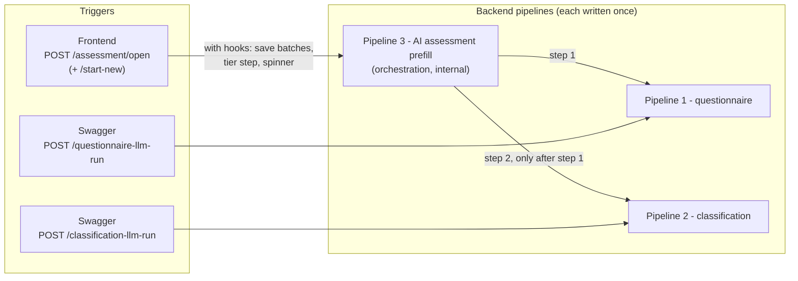
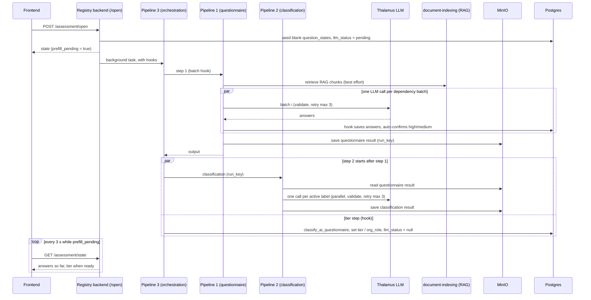

# LLM pipelines — questionnaire, classification and assessment prefill

All LLM work for the assessment runs in **this backend** (`app/llm/` → Thalamus). The frontend never calls an LLM or the `-llm-run` endpoints; it calls `POST /assessment/open` and polls `GET /assessment/state`. There are **three pipelines**, each implemented exactly once:

| # | Pipeline | Function (file) | Does | Trigger |
|---|---|---|---|---|
| 1 | **Questionnaire** | `run_questionnaire_pipeline` (`questionnaire_pipeline.py`) | evidence → batched LLM calls → validate/retry → save result to MinIO | `POST /questionnaire-llm-run` (Swagger, questionnaire only) and pipeline 3 |
| 2 | **Classification** | `run_classification` (`classification_pipeline.py`) | read the saved questionnaire result → one LLM call per active label → validate/retry → save result to MinIO | `POST /classification-llm-run` (Swagger) and pipeline 3 |
| 3 | **AI-assessment prefill (orchestration)** | `run_assessment_prefill_pipeline` (`assessment_prefill_pipeline.py`) | runs pipeline 1, then pipeline 2 — **no LLM, validation or MinIO logic of its own** | **internal only**: started by `POST /assessment/open` (and `/start-new`, which calls `open_assessment`) as a background task, with hooks. No Swagger endpoint. |

**Diagram A — pipelines and their triggers**

**Diagram B — runtime flow when the user starts an assessment**

**Parity (endpoint ↔ assessment).** Pipelines 1 and 2 are the *same functions* whoever triggers them; pipeline 3 only composes them. So a Swagger run and the frontend flow share the evidence, batching, parallel LLM calls, validation + retry rules, `NOT_ENOUGH_INFORMATION`/failure handling, the "no batch succeeded → error" rule, label scoping/skip rules and the MinIO keys. Default ids are shared constants (`DEFAULT_QUESTIONNAIRE_ID/PROMPT_ID`, `DEFAULT_CLASSIFICATION_CONFIG_ID/PROMPT_ID`), so an empty-body `POST` runs exactly the parameters the assessment runs. The only difference is pipeline 3's two **hooks**, passed by `/open` only: `batch_callback` (`_on_batch`: write each batch into `question_states`, auto-confirm high/medium) and `on_questionnaire_done` (`_finalize_tier`: `classify_ai_questionnaire` → tier/basis/`org_role`/`assessment_sources`, clear `llm_status`, one transaction). The Swagger endpoints never touch assessment/system rows, so a developer test cannot alter a live cycle. Pinned by `tests/e2e/test_assessment.py::test_swagger_pipelines_match_what_the_assessment_start_ran`.

**Failure policy (pipeline 3).** Questionnaire run fails (or *no* batch produced a valid result) → exception → `llm_status="failed"` → the frontend's "AI pre-fill failed, retry" banner. `_finalize_tier` raises → same. The **classification run failing as a whole** (config/prompt missing, MinIO read error…) does **not** fail the prefill: pipeline 3 returns it as `PrefillOutput.classification_error` and logs `assessment_prefill.classification_failed` — its output is not shown in the UI yet (#371), so the owner's answers and tier are unaffected. Individual label failures are skipped inside pipeline 2.

**LLM output validation** (`app/llm/validators.py` + `app/llm/parsing.py`; runs inside pipelines 1 and 2, so every trigger gets it). `parse_with_retry` makes up to **3 LLM attempts**; a retry keeps the original output-token cap (`max_tokens`) and a `finish_reason=length` retry counts as failed.
- *Syntax failure* (not a JSON **object** — a top-level array/string is rejected too) → retry with the JSON-repair prompt (`json_repair_*`).
- *Contract failure* (valid JSON, wrong content) → re-ask with the **original messages + the model's previous answer + the list of violations** (`context/prompts/json_validation_retry.md`), so the model re-reads the evidence. Validators report **all** violations in one error (cap 10).
- `validate_questionnaire_batch(raw, batch)`: every `questionId` belongs to the batch, no duplicates, **every batch question answered**, `questionType` matches the config, PREDEFINED has exactly one answer item, every value is one of the question's `allowedAnswers` or `NOT_ENOUGH_INFORMATION`/`CONFLICT`/`NOT_APPLICABLE`, MULTISELECT values unique, `NOT_APPLICABLE` exclusive and never `LOW`, `NOT_ENOUGH_INFORMATION`/`CONFLICT` the only item with `answerStrength` null — every other value needs `HIGH`/`MEDIUM`/`LOW`.
- `validate_classification_label(raw, expected_label_id)`: exactly one entry whose `labelId` is the requested label, boolean `result`, 0–100 `confidence`, non-empty `explanation`.
- `validate_answer_entries(entries)`: the same answer rules applied as a pre-flight to the *stored* answers pipeline 2 is about to send.

**Pipeline 3 — AI-assessment prefill** (`app/assessment_prefill_pipeline.py`): `run_assessment_prefill_pipeline(system_id, username, *, questionnaire_id, questionnaire_prompt_id, classification_config_id, classification_prompt_id, batch_callback=None, on_questionnaire_done=None) -> PrefillOutput(questionnaire, classification | None, classification_error | None)`. Step 1 = pipeline 1 (with `batch_callback`); step 2 = pipeline 2 on step 1's `run_key`, run **concurrently with** `on_questionnaire_done(questionnaire_output)`. A hook exception propagates; a classification failure is captured (see **Failure policy**). Future step 3 (#371 hierarchy resolver) is added here.

## Where to look

- Per-pipeline details (evidence allowlist, storage keys, config, stub mode, manual `curl` triggers): [`ai-system-registry/CLAUDE.md`](../ai-system-registry/CLAUDE.md).
- Code: `ai-system-registry/backend/app/` — `questionnaire_pipeline.py`, `classification_pipeline.py`, `assessment_prefill_pipeline.py`, `llm/parsing.py`, `llm/validators.py`, `routers/assessment.py` (`_run_prefill_background`).
- Tests: `tests/unit/test_{questionnaire_pipeline,classification_pipeline,assessment_prefill_pipeline,validators,parsing}.py` and `tests/e2e/test_assessment.py` (parity + failure policy).
