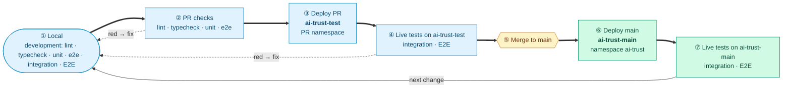

# Test Strategy — AI Trust Platform MVP

## Test levels

| Repo term | Industry term | Boundary | MVP |
|---|---|---|---|
| Lint / typecheck | Static analysis | Code validation | ✅ |
| Unit | Unit | Pure logic, no I/O | ✅ |
| E2E per service | End-to-end micro service | One service in-process, other services mocked | ✅ |
| Integration | Cross-service technical integration | Technical contracts between deployed services over real HTTP: shared data, RBAC enforcement, cascades, internal calls. See [Integration scenarios](#integration-scenarios) | ✅ |
| E2E System | System / end-to-end (API level), domain | MVP business requirements: full happy-path persona flows driven black-box through the whole deployed platform; no browser or login. See [E2E system scenarios](#e2e-system-scenarios) | ✅ |
| Deployment test | Deployment verification | Helm/OCM rollout healthy, K8s liveness & readiness probes.| ✅ |
| AI output evaluation | ML evaluation | Accuracy of AI-assisted classification against a labelled dataset. See [AI output evaluation](#ai-output-evaluation) | ✅ |
| Frontend tests | Component / visual regression | React component behaviour and visual states, driven black-box through a real browser; tool: Playwright (Apache 2.0). See [Frontend tests](#frontend-tests) | ✅ |
| Performance / load | Performance | Throughput, latency, and race-condition checks under load | TBD |

**Test Coverage: measure, don't gate.** `pytest-cov` runs in report-only mode with no threshold; it never
fails a build (see [Test Code Coverage](#test-code-coverage)).

---

## Development loop

One change goes round the loop: develop → PR checks → deploy to `ai-trust-test` → live tests →
merge → deploy to `ai-trust-main` → live tests → next change. A red step sends the change back to
**Develop**.

## Integration scenarios

**Cross-service technical integration**: proof that deployed services work together at their technical
seams — shared data integrity, RBAC enforcement across backends, cascade side-effects, internal HTTP
calls, and platform wiring. These run in-cluster (kind or Gardener) over real HTTP. A failure points
to a broken technical contract, not a missing business requirement.

The integration tests talk directly to backend ports (via kubectl port-forward), so they never go through oauth2-proxy or Keycloak

Legend: ✅ test covered · ⬜ test missing, functionality exists

### A. Platform wiring and reachability

| Scenario | State |
|---|---|
| Health of all backends (each `/health` also checks its DB connection) | ✅ `test_01_health.py` |
| Shell entry page is served (HTTP 200, HTML) | ⬜ |
| MVP frontends (Registry, Compliance) are served through the shell proxy (HTTP 200, HTML) | ⬜ |
| MVP backend APIs (Registry, Compliance) are reachable through the shell proxy | ⬜ |

### B. Registry ↔ Compliance

| Scenario | State |
|---|---|
| Registered system is resolvable by compliance (shared FK integrity) | ✅ `test_02_registry_compliance.py` |
| Assessment creation auto-generates obligations and requirements for all tiers | ✅ `test_02_registry_compliance.py` |
| Approved evidence cascades compliance score back to `ai_systems.compliance` | ✅ `test_02_registry_compliance.py` |
| Rejected evidence reverts compliance score | ✅ `test_02_registry_compliance.py` |
| Delete assessment including dependencies (obligations, requirements) and associated risk classification on the system | ⬜ |
| Document upload → link to system → delete attempt blocked → unlink → delete succeeds | ⬜ |
| Audit flush worker — event written to Postgres buffer → flushed to ClickHouse → deleted from Postgres | ⬜ |
| Assessment submitted to CO → `workflow_status` transitions correctly through all states (`draft → pending_assessment → pending_review → approved`) | ⬜ |
| CO request-info → section re-opened → submit-info → reclassification → back to `pending_review` | ⬜ |
| Per-question assignment → contributor answers → approval gate enforced | ⬜ |

### B2. Backend contracts

Technical invariants enforced by individual backends, independent of cross-service data flow.

| Scenario | State |
|---|---|
| Document upload size cap (20 MB) rejected by the backend before reaching MinIO | ⬜ |
| Presigned MinIO URLs expire within the configured TTL and are not reusable after expiry | ⬜ |
| Audit trail is append-only — no DELETE or UPDATE path exists in the audit backend API | ⬜ |

### C. RBAC (cross-service)

These scenarios verify that role checks are enforced at the API level across service boundaries, not
just in the frontend. All 403 scenarios are tested at the API level, not the frontend.

| Scenario | State |
|---|---|
| Auditor cannot write systems (403) | ✅ `test_03_rbac.py` |
| Platform Administrator cannot read assessments (403) | ✅ `test_03_rbac.py` |
| Admin stats endpoint aggregates correctly across backends | ✅ `test_03_rbac.py` |
| AI Engineer cannot approve evidence (403) | ✅ `test_03_rbac.py` |
| AI Engineer can write systems | ⬜ |
| AI Business Owner can write systems | ⬜ |
| AI Engineer can start an assessment | ⬜ |
| AI Business Owner can start an assessment | ⬜ |
| Assignee can unassign themselves within an assessment | ⬜ |
| Person who assigned others can unassign those assignees within an assessment | ⬜ |
| Compliance Officer can forward an assessment to a different Compliance Officer | ⬜ |
| Compliance Officer can send an assessment back to the responsible person to provide more information | ⬜ |
| Compliance Officer can confirm and finish an assessment | ⬜ |

---

## E2E system scenarios

**Full happy-path business flows**: proof that the MVP flow works end-to-end as the business requires
for each persona. Each scenario is a complete flow driven black-box through the whole deployed
platform. These are the MVP acceptance criteria. A failure points to an unmet business requirement.

Legend: ✅ test covered · ⬜ test missing, functionality exists

### 0. Authentication

| Scenario | State |
|---|---|
| User authenticates via Keycloak OIDC → oauth2-proxy issues a session cookie → shell is reachable through port 8080 | ⬜ |

### 1. Registration

| Scenario | State |
|---|---|
| AI Engineer registers a new system end-to-end through the shell proxy | ⬜ |
| AI-assisted registration: conversational intake and an uploaded document pre-fill the registration fields | ⬜ |

### 2. Self-assessment

| Scenario | State |
|---|---|
| Application Owner submits the business section → AI Engineer submits the technical section → system `pending_review` | ⬜ |
| Section owner delegates a question to a sub-assignee → sub-assignee answers → owner reclaims | ⬜ |

### 3. Risk classification

| Scenario | State |
|---|---|
| Full governance chain: register system → fill assessment (AI Engineer + Application Owner) → AI-based preclassification → submit to CO → CO approves → confirmed classification | ⬜ |
| Bounce-back flow: CO requests info → section reopened → owner resubmits → system reclassified → CO approves | ⬜ |

### 4. Classification confirmation

| Scenario | State |
|---|---|
| Compliance Officer approves → system `approved` (registry) and assessment `approved` (compliance); risk flags locked | ⬜ |
| Compliance Officer corrects tier and/or EU AI Act role on approval → corrected values stored | ⬜ |

### 5. Requirements — outside MVP scope (regression only)

| Scenario | State |
|---|---|
| Assessment creation generates requirements for each obligation | ✅ `test_02_registry_compliance.py` |

### 6. Evidence upload — outside MVP scope (regression only)

| Scenario | State |
|---|---|
| Evidence uploaded and linked to a requirement | ✅ `test_02_registry_compliance.py` |

### 7. Approval — outside MVP scope (regression only)

| Scenario | State |
|---|---|
| Evidence approval / rejection cascades compliance score to registry | ✅ `test_02_registry_compliance.py` |

Monitoring follows Approval in the lifecycle and is outside MVP scope; no E2E system scenarios.

---

## Frontend tests

**Tool: [Playwright](https://playwright.dev/)** (`@playwright/test`, TypeScript) — Apache 2.0
licensed, runs on standard GitHub-hosted runners without additional infrastructure. The suite lives
in [`tests/playwright/`](../tests/playwright/) and drives a **real browser** black-box against a
**live** platform through the single entry point (oauth2-proxy on `APP_URL`), authenticating with a
**real Keycloak OIDC login** — the browser-level counterpart of `tests/e2e_system/`.

**How it runs.** Locally against kind (`APP_URL=http://localhost:8080`) or any deployed namespace;
in CI via the **`playwright-test`** PR label
([`.github/workflows/playwright-frontend-tests.yml`](../.github/workflows/playwright-frontend-tests.yml)),
which runs against the PR author's already-deployed `ai-trust-test` namespace (deploy it first with
`garden-deploy`). The HTML report and `test-results/` (traces, **failure screenshots**, videos) are
uploaded as CI artifacts. **Not a PR gate** (same model as the `e2e-test` / `langfuse-test` labels).

**Auth & personas.** A Playwright `setup` project provisions personas via the users API and captures
one `storageState` per persona (reused by every spec); a `teardown` project deletes the created
users and systems even on failure. Two personas cover all six MVP MFEs because the shell nav is
permission-gated: `engineer` (`ai_engineer`) sees registry/compliance/audit/overview and can register
systems; `admin` (`platform_administrator`, `iam:manage`) sees admin and users/IAM.

### Initial scenarios (MVP baseline)

Legend: ✅ test covered · ⬜ test missing, functionality exists

| Kind | Scenario | State |
|---|---|---|
| Smoke | Registry MFE mounts (heading "AI System Registry") + backend healthy | ✅ `tests/playwright/tests/smoke-engineer.spec.ts` |
| Smoke | Compliance MFE mounts (heading "Assessments") + backend healthy | ✅ `tests/playwright/tests/smoke-engineer.spec.ts` |
| Smoke | Audit MFE mounts (heading "Audit Trail") + backend healthy | ✅ `tests/playwright/tests/smoke-engineer.spec.ts` |
| Smoke | Overview MFE mounts (heading "Compliance Overview") + backend healthy | ✅ `tests/playwright/tests/smoke-engineer.spec.ts` |
| Smoke | Admin MFE mounts (heading "Platform Administration") + backend healthy | ✅ `tests/playwright/tests/smoke-admin.spec.ts` |
| Smoke | Users/IAM MFE mounts (heading "Users & Roles") + backend healthy | ✅ `tests/playwright/tests/smoke-admin.spec.ts` |
| Deep | AI Engineer registers a new system end-to-end (form → toast → list row) | ✅ `tests/playwright/tests/registry-register.spec.ts` |

"Mounted" asserts the view's stable heading is visible; "healthy" asserts the red health banner
("Backend is unavailable…") is absent. Selectors are user-facing (role/label/text) — the frontends
expose no `data-testid`.

### Conventions

- **User-facing selectors only** — `getByRole` / `getByLabel` / `getByText`, never CSS classes or
  XPath; web-first auto-waiting assertions (`await expect(...)`), never fixed sleeps.
- **Deterministic data** — the registry deep flow uses name + description only (no document upload,
  no AI mode), so it never depends on the Thalamus/LLM backend.
- **Isolation** — each run uses a unique suffix (`E2E_SUFFIX`) and cleans up after itself; the suite
  does not share state with the Python suites.
- **No duplication of lower layers** — browser tests assert UI behaviour; API contracts and RBAC
  denials stay in `tests/e2e_system/` and `tests/integration/`.

### Future path (out of MVP scope)

- **Visual regression** via `toHaveScreenshot()` pixel baselines — deferred: baselines are
  environment-sensitive (fonts/rendering) and a common cross-runner flake source. Revisit once the
  interaction baseline is stable and a canonical rendering environment is pinned.
- Additional browsers (firefox/webkit), the deep self-assessment / classification flows, and the
  MVP-off MFEs (ai-test-bed, monitoring, alerts, dta).

---

## AI output evaluation

> **To be refined.** Metrics and thresholds are not decided. Will be covered with AI Assisted functionality implementation.

Placeholder scope, to be confirmed:
- **What:** accuracy of the AI-assisted RCE: flags extracted from questionnaire answers and uploaded
  documents, and the resulting tier and EU AI Act role, against a labelled dataset covering all tiers.
- **Inputs:** labelled dataset, evaluation pipeline and test bed (planned).
- **Relation to functional tests:** integration and E2E system tests prove the workflow works with a deterministic
  stub. Evaluation proves the AI output is good enough.
- **To decide:**
  - metrics (per-tier precision/recall?) and MVP thresholds
  - confidence calibration, needed if a confidence threshold routes classifications
  - label mapping: the MVP scope uses combined classes (e.g. high risk + transparency), while the
    classifier returns a single tier and also has GPAI tiers
  - which LLM provider and model is evaluated, and whether evaluation runs in CI or on demand

---

## Test Code Coverage

**Measure, don't gate.** Coverage is reported, not enforced:

- **Tool:** `pytest-cov` (line coverage; branch coverage optional).
- **Mode:** report-only. **No threshold**, no `--cov-fail-under`, no PR or `main` gate. A low number
  never fails a build.
- **Scope:** the in-process levels: unit and per-service E2E (`tests/unit/`, `tests/e2e/`). The live
  platform levels (integration, E2E system) are black-box over HTTP and are not measured for code
  coverage; they are measured by the business and technical scenarios above.
- **Output:** a terminal summary and an XML/HTML report per backend, available as CI artifacts. No
  external coverage service for now.
- **Purpose:** build a baseline and spot untested areas. Targets and any gate are decided later,
  once baseline data exists. Until then, MVP acceptance is measured by the business scenarios above.

